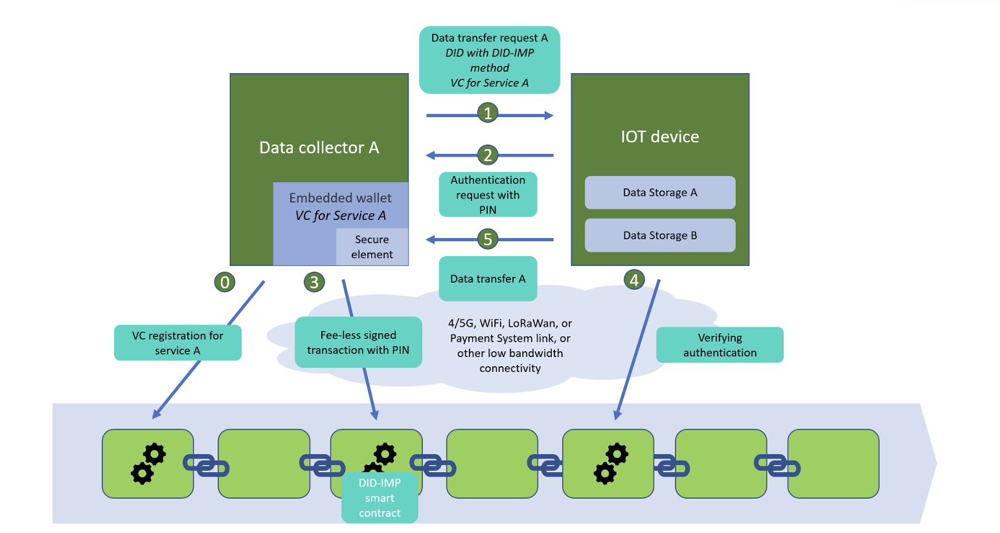
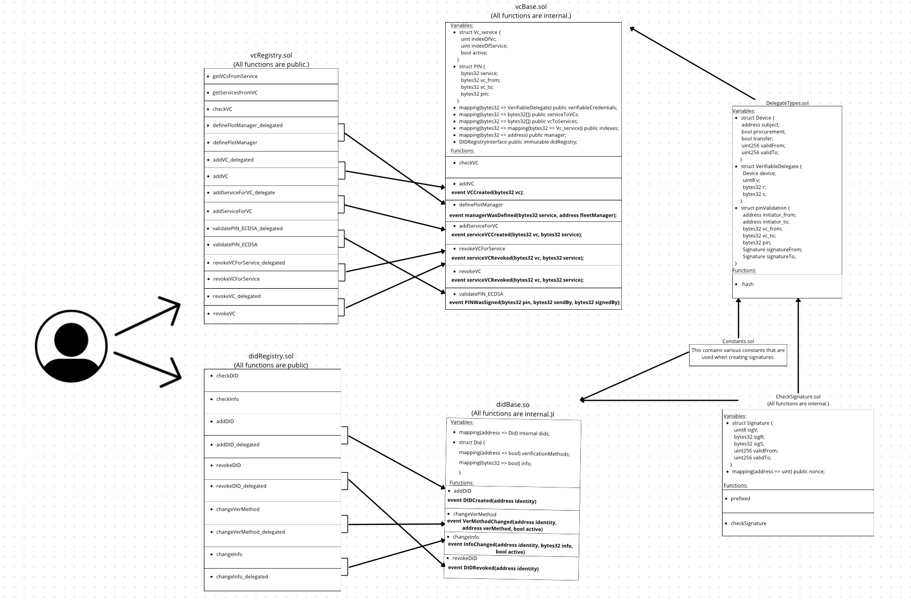

import Link from '@docusaurus/Link';

# Infrastructure à clés publiques décentralisée pour la gestion et l'échange sécurisés des données IoT

L'Internet des objets (IoT) fait de plus en plus partie du quotidien, de la maison connectée aux systèmes industriels complexes. Près de la moitié des 160 Zo (zettaoctets) de données produits aujourd'hui dans le monde proviennent d'objets connectés. Même s'il est difficile de déterminer la taille exacte du marché, en raison de la diversité des segments et des applications, plusieurs cabinets d'études ont estimé celle du marché du Big Data.

Selon diverses études de marché réalisées entre 2020 et 2021, le marché du Big Data était évalué entre 138,9 et 156 milliards de dollars, avec une croissance annuelle composée (TCAC) attendue significative dans les années à venir. Ces études identifient la pénétration croissante des appareils mobiles et le besoin grandissant de processus de partage de données simplifiés comme les principaux moteurs de cette croissance. Le marché de l'échange automatisé de données IoT croît lui aussi rapidement, avec un fort potentiel, dans la lignée de cette tendance générale.

Malheureusement, plus le nombre d'objets dans un système augmente, plus le besoin d'un partage de données fiable et efficace, et de leur protection, augmente aussi. Aujourd'hui, nos identités en ligne sont gérées par des institutions centralisées comme les banques, les États ou les réseaux sociaux. Ce modèle ne convient pas aux objets connectés, qui peuvent, et dans certains cas doivent, être autonomes, avec une mémoire ou une puissance de calcul limitée, et fonctionner dans des environnements peu fiables.

Les smart contracts et la blockchain permettent aujourd'hui de répondre à ces problèmes. Décentralisée et immuable, la blockchain offre un haut niveau de sécurité et de transparence : c'est une base solide pour développer des systèmes IoT sécurisés.

Construire une infrastructure à clés publiques décentralisée pour les objets connectés permet évidemment de retirer tous les organismes centraux de l'écosystème de nombreuses entreprises. L'utilisateur final redevient ainsi le centre de l'architecture technique des services proposés par ces objets connectés.

Cela met en effet au premier plan l'évaluation de la fiabilité des données, l'interopérabilité et la pérennité de l'identité numérique, ainsi que la minimisation des données (une exigence du RGPD).

Notre concept propose une méthode de pointe pour authentifier les objets d'un réseau IoT grâce aux smart contracts. Notre objectif est de développer une plateforme d'authentification des objets et de gestion des services, qui permet aux utilisateurs d'interagir de façon sûre et efficace au sein de l'écosystème IoT.

Notre méthode répond à plusieurs enjeux majeurs de la sécurité de l'IoT :
1) Authentification des objets : la garantie d'authentification des objets élimine le risque d'usurpation d'identité.
2) Vérification des données : elle garantit la validité des données issues des objets, ce qui est particulièrement important pour les applications critiques.
3) Gestion des services : elle offre un système souple et capable de passer à l'échelle pour gérer les interactions entre objets et services.

Notre solution vise à renforcer la confiance dans les systèmes IoT tout en améliorant leurs fonctionnalités et leur sécurité. Elle ouvre de nouvelles possibilités pour créer et déployer des services intelligents, capables de transformer de nombreux aspects de notre vie et de notre travail.

## DESCRIPTION DU PROJET

</img>

A. Vue d'ensemble des composants principaux

L'infrastructure à clés publiques décentralisée de DID-IMP doit permettre à tout objet connecté de s'identifier automatiquement et de partager ou d'obtenir des données de façon sécurisée. Nous développerons les composants logiciels clés pour livrer un produit pleinement fonctionnel (fig. 1), au niveau de maturité technologique (TRL) 7 ou 8. Pour cela, l'architecture proposée reposera sur :

1) Un réseau blockchain public : la blockchain de couche 1 sera choisie en cohérence avec l'orientation stratégique de TRUSTCHAIN, en tenant compte du besoin d'une EVM pour faciliter la mise en œuvre. Le coût (frais de gas) du réseau choisi sera déterminant pour garantir la viabilité économique de la solution.

2) Un ensemble de smart contracts : ils serviront à émettre et à révoquer les certificats. Ils permettront aussi d'automatiser sans frais le traitement du partage de données et d'en faire respecter les conditions. Pour réaliser des transactions sans frais :
    
-  nous utiliserons les possibilités d'Alastria, une blockchain publique à permissions, pour transférer des données sans frais ;

- pour étendre les capacités de notre solution, y compris à d'autres blockchains, chaque fonction de nos smart contracts aura un paramètre de signature. Les objets qui veulent interagir avec les smart contracts doivent signer les paramètres de la fonction avec la clé privée de leur compte et les envoyer au propriétaire du smart contract (par n'importe quel canal de communication). Le propriétaire soumet alors les paramètres et la signature à la blockchain, en payant le gas. La signature garantit que le message a bien été approuvé par l'utilisateur.

3) Un portefeuille embarqué : ce logiciel sera conçu pour fonctionner dans les objets connectés. Il servira à gérer la monnaie numérique et les jetons associés à la solution blockchain de partage de données IoT, ou des volumes de données. Selon sa configuration, il pourra stocker, envoyer et recevoir des données. La gestion des DID et des VC pourrait s'appuyer sur le projet Veramo. Ce projet open source nous permet soit de l'utiliser comme point de départ et de l'intégrer à notre produit, soit de l'adapter à nos objectifs en nous en servant comme fondation.

4) Une interface utilisateur : une application web destinée aux fournisseurs de services IoT, pour activer et révoquer les certificats. Cet outil est l'interface visuelle qui permet de gérer et de tracer les certificats des données et des objets, ainsi que de détecter les fraudes et de résoudre les litiges.

5) Une version mobile de l'interface utilisateur, avec une sélection des principales fonctions d'administration.

B. Principe de fonctionnement

1) Enregistrement et création de services :

- Les utilisateurs enregistrent leurs objets en créant des DID et en les associant à d'autres adresses.
    
- Tout utilisateur disposant d'un DID peut créer un « service » (par exemple « Données de température dans les différentes pièces de la maison ») et en devenir le propriétaire.
    
- Les détenteurs de VC peuvent rejoindre le service via un smart contract et former ainsi un parc d'objets qui fonctionnent ensemble.

2) Échange de données entre objets connectés :

- Chaque objet dispose d'un portefeuille blockchain intégré pour signer les données. Pour communiquer, deux objets échangent leurs DID et leurs VC.

- L'objet émetteur vérifie les informations de l'objet récepteur.
    
- Si la vérification réussit, l'objet émetteur génère un code PIN et l'envoie à l'objet récepteur.
    
- L'objet récepteur signe le code PIN en exécutant une transaction sur la blockchain.
    
- L'objet émetteur vérifie la transaction et, si elle est correcte, envoie les données.

Au total, notre solution blockchain s'appuie sur un ensemble de composants logiciels qui travaillent ensemble pour assurer un partage de données sécurisé et décentralisé entre objets et services connectés. Ces composants seront conçus pour garantir un haut niveau de sécurité, d'efficacité et de simplicité d'utilisation.

## AVANTAGES SELON LES CRITÈRES D'ÉVALUATION

- Décentralisation : fidèle au concept des DID, la solution fonctionnera de façon décentralisée, sans point de défaillance unique, et aucune autorité centrale ne pourra compromettre l'intégrité du réseau ni y jouer un rôle prépondérant.

- Passage à l'échelle : compte tenu du nombre potentiellement immense d'objets connectés, la solution pourra gérer un nombre important et en forte croissance d'identifiants, ainsi qu'un très grand volume de transferts de données.

- Sans frais : une bonne solution DID doit être sobre en consommation de gas sur la blockchain ; nous la concevrons donc sans frais pour les utilisateurs.

- Maturité : nous avons échangé avec des clients potentiels et développons la solution en fonction de leurs besoins.

- Simplicité d'utilisation (application) : nous visons une application simple, qui n'oblige pas l'utilisateur final à passer du temps à comprendre comment gérer ses objets.

- Identification fiable des objets : le projet démontrera une grande fiabilité dans l'identification des objets connectés, grâce à des DID et des VC uniques vérifiés sur la blockchain, qui offrent le haut niveau de sécurité et de confiance indispensable aux écosystèmes IoT.

## EXEMPLES D'APPLICATION

Nous décrivons ici des scénarios concrets dans lesquels notre solution pourrait être utilisée.

A. Véhicules connectés

Avec DID-IMP, les véhicules pourraient transmettre automatiquement des données sur le stationnement, la recharge et d'autres services de transport, pour une expérience plus confortable pour les conducteurs. Ils pourraient envoyer leurs données d'entretien grâce au transfert de données IoT entre les objets du parc de leur organisation.

Dans le cas le plus simple, le système de la station communique avec le véhicule et l'authentifie, ainsi que son propriétaire, grâce à DID-IMP pour un échange de données sécurisé. Le pistolet de remplissage équipé de capteurs IoT se connecte automatiquement au réservoir du véhicule, lance le remplissage et surveille la pression et la température pour optimiser la sécurité. Une fois le plein terminé, un reçu numérique est envoyé sur le smartphone du conducteur, qui peut aussi y consulter l'historique de ses transactions et des indicateurs de consommation.

B. Santé à distance

DID-IMP pourrait améliorer l'accès à la téléconsultation et à la surveillance des patients à distance, tout en garantissant la sécurité et la personnalisation des données. Par exemple, un utilisateur possède différents objets connectés de suivi de santé : bracelet d'activité, balance connectée, tensiomètre, etc. Son téléphone collecte leurs données via l'application DID-IMP et les synchronise avec son dossier médical électronique. À partir de ces données, l'application médicale peut formuler des recommandations personnalisées, signaler d'éventuels problèmes de santé, voire prévenir les secours et les proches de l'utilisateur en cas d'urgence.

C. Villes cognitives

DID-IMP pourrait permettre des échanges de données sécurisés entre objets connectés et contribuer ainsi à des villes intelligentes, ou cognitives. Les utilisateurs enregistrent leurs objets dans l'application DID-IMP et les associent à des identifiants décentralisés (DID) et à des certificats vérifiables (VC).

Une fois l'enregistrement fait, ils pourraient personnaliser les réglages selon leurs préférences : choix des objets avec lesquels communiquer, paramètres de partage des données, notifications en temps réel. Avec DID-IMP, les utilisateurs peuvent facilement se connecter aux objets connectés de la ville pour suivre le trafic, contrôler leur consommation d'eau, gérer leurs déchets et recevoir des alertes de sécurité. Les objets échangent leurs données par des smart contracts, ce qui garantit que les informations sont vérifiées et protégées.

DID-IMP protège les données personnelles, contribue aux objectifs de développement durable de la ville et donne accès à une variété de services innovants qui rendent la vie plus pratique et plus sûre.

D. Gestion de l'énergie

DID-IMP permet de gérer de façon sécurisée les objets connectés du secteur de l'énergie, comme les compteurs intelligents et les capteurs du réseau. Les utilisateurs enregistrent leurs objets dans l'application DID-IMP, ce qui permet un échange de données précis et sécurisé.

L'application fournit en temps réel des données sur la consommation et la distribution d'énergie : les utilisateurs suivent les tendances et reçoivent des alertes en cas de problème. Ils peuvent aussi participer à des communautés d'énergie locales et partager leurs données pour optimiser la consommation et développer les énergies renouvelables.

DID-IMP simplifie l'enregistrement et la gestion des objets connectés, le suivi de l'énergie et la participation aux communautés d'énergie, grâce à un partage de données sécurisé.

E. Maison connectée

DID-IMP pourrait permettre de piloter de façon sécurisée les objets de la maison connectée, comme les thermostats ou les caméras. Les utilisateurs téléchargent l'application DID-IMP et suivent une configuration simple : ils enregistrent chaque objet et l'associent à un DID.

L'application DID-IMP permettrait un suivi en temps réel et enverrait des notifications lors d'événements comme un mouvement devant une caméra ou un changement de température. Il devient ainsi possible de surveiller la sécurité, la consommation d'énergie et l'état de la maison.

Bien sûr, la confidentialité et la sécurité des données sont primordiales pour un aspect aussi privé de la vie que notre domicile. DID-IMP utiliserait des mécanismes d'authentification pour empêcher tout accès non autorisé.

F. Chaîne d'approvisionnement

DID-IMP permet de tirer parti de l'IoT pour la logistique et la gestion de la chaîne d'approvisionnement, grâce à des échanges de données sécurisés pour suivre la position, l'état et le statut des marchandises pendant leur transport, et ainsi prévenir les vols, les dommages ou les manipulations.

Par exemple, une entreprise de logistique spécialisée dans le transport de denrées périssables peut utiliser DID-IMP pour intégrer des objets connectés comme des capteurs de température et des traceurs GPS. Une fois l'intégration réalisée, elle dispose d'un tableau de bord qui affiche en temps réel la position et la température de chaque objet. Des notifications automatiques en cas d'écart ou d'événement imprévu permettent d'agir immédiatement pour éviter que les marchandises ne se gâtent. L'application permet aussi d'analyser l'historique des données, de repérer des tendances et d'optimiser les livraisons. Une bonne intégration avec les autres systèmes de l'entreprise améliore la visibilité et la transparence de la chaîne d'approvisionnement, et facilite la collaboration entre ses acteurs.

## DÉTAILS TECHNIQUES

Ce chapitre présente brièvement les principales caractéristiques structurelles de la mise en œuvre des smart contracts, qui sont au cœur du projet.

Le système comprend sept smart contracts :

1) DidBase : fonctions de base de gestion des DID (toutes conçues pour n'être appelées que depuis le contrat qui en hérite) ;

2) VCBase : fonctions de base de gestion des VC (toutes conçues pour n'être appelées que depuis le contrat qui en hérite) ;

3) CheckSignature : fonction de vérification des signatures ;

4) DelegateTypes : définition de la structure de base des VC et du
hachage ;

5) Constants : un ensemble de constantes de type bytes32 utilisées pour la
signature des données ;

6) DIDRegistry : appelle les fonctions de DidBase ; à chaque fonction de DidBase correspondent deux fonctions, l'une appelable directement par l'adresse du DID, l'autre qui accepte des données signées et peut être appelée par une adresse sans lien avec le DID ;

7) VCRegistry : appelle les fonctions de DidBase ; à chaque fonction de DidBase correspondent deux fonctions, l'une appelable directement par l'adresse du DID, l'autre qui accepte des données signées et peut être appelée par une adresse sans lien avec le DID.

</img>

## CONCLUSION
Nous pensons que ce projet est un pas vers une meilleure sécurité et une plus grande efficacité des données dans de nombreux domaines, grâce aux identifiants décentralisés (DID) et aux certificats vérifiables (VC). En faisant des smart contracts le socle du système, nous posons une base fiable pour l'échange et la vérification sécurisés des données.

Une fois les principaux éléments de l'application développés, nous envisageons les prochaines étapes suivantes pour le projet :

- Mettre en œuvre la technologie des NFT (jetons non fongibles) pour tokeniser le transfert de données, ce qui améliorera la transparence et l'efficacité du système. Cela facilitera aussi l'intégration du projet dans les domaines où les données sont payantes.

- Explorer et proposer différentes méthodes de transfert de données, notamment en utilisant les transactions non seulement pour la vérification mais aussi pour stocker les données envoyées, afin de renforcer encore la sécurité et la fiabilité du système. Les utilisateurs pourront ainsi choisir différents niveaux de sécurité et de confidentialité selon leurs besoins.

- Mettre en œuvre des technologies de preuve à divulgation nulle de connaissance (zero-knowledge proof) pour maximiser la protection des données et l'anonymat, et rendre le système encore plus sûr et attractif pour les utilisateurs. Ces étapes permettront d'améliorer notre projet et d'étendre ses capacités, pour le rendre encore plus utile et prometteur dans le monde numérique.
