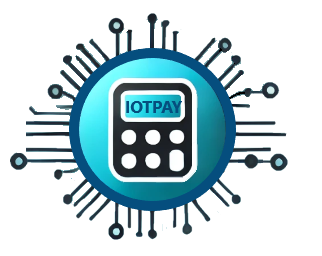
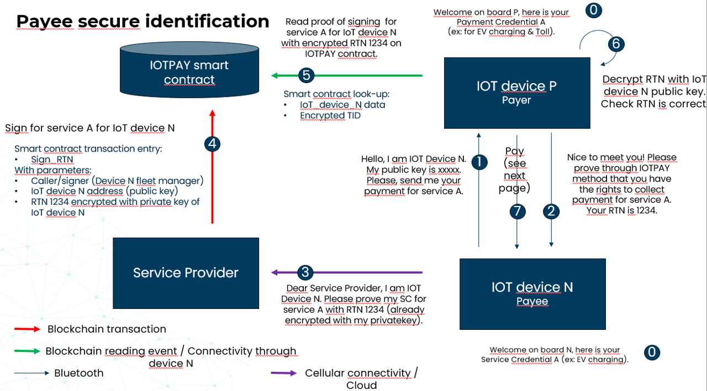
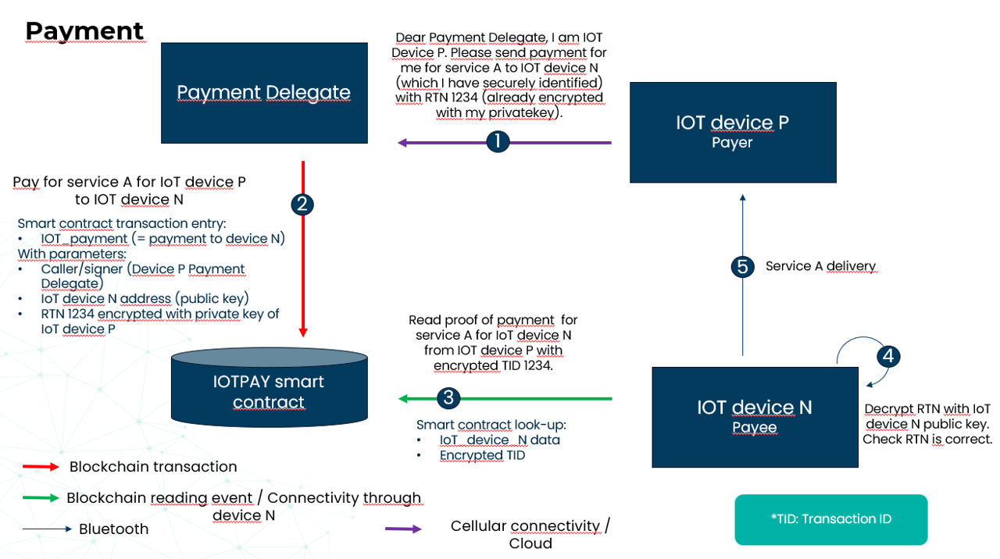

import Link from '@docusaurus/Link';

# Un système de paiement autonome et décentralisé pour les objets connectés

Dans notre monde interconnecté, l'Internet des objets (IoT) prend une place croissante, de la maison connectée aux systèmes industriels complexes. La multiplication des objets connectés a entraîné une hausse exponentielle des données produites : selon les estimations, les objets connectés contribuent largement aux 160 zettaoctets (Zo) de données générées dans le monde. Cette explosion rend indispensables des systèmes de paiement efficaces, sécurisés et autonomes, adaptés aux écosystèmes IoT.

## Description du projet

Les infrastructures de paiement classiques sont souvent mal adaptées au fonctionnement autonome et décentralisé des objets connectés. Le besoin d'intervention humaine, les frais de transaction et les failles de sécurité freinent le bon fonctionnement des réseaux IoT. Pour relever ces défis, Werenode a développé IOTPAY, un système de paiement autonome et décentralisé conçu spécifiquement pour les objets connectés.

IOTPAY est un projet de recherche de Werenode, développé dans le cadre de NGI Sargasso, un programme financé par l'UE qui vise un Internet centré sur l'humain, digne de confiance et durable. Le projet consiste à créer une infrastructure à clés publiques décentralisée adaptée aux objets connectés, avec des smart contracts sur la blockchain qui permettent un partage de données sécurisé, traçable et sans frais entre objets connectés. En supprimant les intermédiaires, IOTPAY permet des transactions directes entre objets, plus efficaces et moins coûteuses. Grâce à la blockchain, la solution offre davantage de sécurité et de transparence : c'est une réponse solide à l'évolution rapide de l'IoT.

<a href="https://werenode.com/" target="_blank" rel="noopener noreferrer">
    </img>
</a>

IOTPAY a été développé dans le cadre de **NGI Sargasso**, appel ouvert n° 3. NGI Sargasso est un projet financé par l'UE (convention de subvention n° 101092887).

<a href="https://ngisargasso.eu/" target="_blank" rel="noopener">
    </img>
</a>

## Fonctionnalités clés

1) Paiements autonomes et décentralisés : suppression des intermédiaires, avec des transactions directes entre objets connectés.
2) Transactions sans frais : réduction des coûts liés aux systèmes de paiement classiques.
3) Sécurité renforcée : la blockchain garantit des transactions sûres et traçables.
4) Coûts d'exploitation réduits : des processus simplifiés et moins de charges administratives.
5) Meilleure traçabilité : des historiques de transactions transparents pour l'audit et la conformité.
6) Passage à l'échelle facile : conçu pour accompagner sans difficulté la croissance des réseaux IoT.
7) Efficacité en temps réel : des transactions instantanées pour un système plus réactif.

Grâce à la blockchain, IOTPAY garantit que chaque transaction est sécurisée, transparente et traçable, ce qui renforce la confiance au sein du réseau. Cette approche décentralisée simplifie les processus et réduit nettement les charges administratives, pour un fonctionnement plus efficace.

Conçu pour passer à l'échelle, IOTPAY accompagne sans difficulté l'expansion rapide des réseaux IoT, avec des performances constantes quelle que soit leur taille. Son architecture prend en charge les transactions en temps réel, ce qui rend le système plus réactif et permet d'échanger des données et de prendre des décisions immédiatement. En réduisant les frais de transaction, IOTPAY rend les micro-transactions économiquement viables et ouvre de nouvelles possibilités aux applications IoT qui reposent sur des échanges fréquents et de faible valeur.

La traçabilité renforcée d'IOTPAY fournit des historiques de transactions transparents, qui facilitent l'audit et le respect des normes réglementaires. C'est particulièrement utile dans les secteurs où l'intégrité des données et la responsabilité sont essentielles. En réunissant ces capacités, IOTPAY améliore l'efficacité opérationnelle et favorise un environnement IoT plus sûr et plus fiable, ouvrant la voie à de nouvelles applications et de nouveaux services dans un paysage numérique en évolution rapide.

## Applications possibles

IOTPAY se prête à de nombreuses applications dans des secteurs variés, en permettant des transactions sécurisées et autonomes entre objets connectés. Grâce à IOTPAY, ces secteurs peuvent gagner en efficacité, en sécurité et en automatisation.

- Gestion de l'énergie dans les bâtiments intelligents : IOTPAY permet des échanges d'énergie sécurisés et valorisés entre objets connectés au sein d'une communauté d'énergie décentralisée, pour optimiser la consommation et favoriser la durabilité.

- Paiement automatique des frais logistiques : la gestion logistique est simplifiée par l'automatisation des paiements liés à des frais ou à des documents numériques, ce qui la rend plus efficace et réduit les interventions manuelles.

- Véhicules connectés : paiements autonomes pour des services comme les péages, le stationnement et la recharge, pour des transports plus pratiques et plus efficaces.

- Santé à distance : transactions sécurisées entre dispositifs médicaux connectés, pour le paiement en temps voulu des services et le partage des données, au bénéfice de la prise en charge des patients.

- Villes cognitives : transactions fluides entre objets interconnectés dans les villes intelligentes, au service des transports publics ou de la gestion des infrastructures.

- Maison connectée : paiements automatiques des services et des équipements de la maison connectée, pour une meilleure expérience et un fonctionnement plus efficace.

- Gestion de la chaîne d'approvisionnement : paiements sécurisés et autonomes tout au long de la chaîne d'approvisionnement, pour plus de transparence et moins de retards.

## Architecture et protocole

L'architecture d'IOTPAY repose sur plusieurs composants principaux :

1) Réseau blockchain public : la couche de base, qui garantit transparence et sécurité.
2) Smart contracts : ils automatisent l'émission et la révocation des certificats, gèrent les processus de partage de données et appliquent les conditions prévues, sans intermédiaire.
3) Portefeuille embarqué : intégré aux objets connectés, il gère la monnaie numérique et les jetons, et facilite les transactions.
4) Interface utilisateur : une application web permettant aux fournisseurs de services IoT de gérer les certificats, de suivre les transactions et de superviser les échanges entre objets.
5) Application mobile : elle offre les principales fonctions d'administration pour gérer objets et services en mobilité.

Voici une vue simplifiée du protocole IOTPAY :

</img>

</img>

## Conclusion

IOTPAY représente une avancée importante dans le domaine de l'IoT, en répondant au besoin crucial de systèmes de paiement autonomes, sécurisés et efficaces. En s'appuyant sur la blockchain et les smart contracts, il supprime les intermédiaires, réduit les coûts et améliore l'efficacité globale des écosystèmes IoT. À mesure que l'IoT se développe, des solutions comme IOTPAY joueront un rôle clé dans l'avenir des objets et services connectés. Le marché est d'ailleurs promis à une forte croissance : les études prévoient un marché total adressable (TAM) de 350 milliards de dollars d'ici 2030, avec un marché réellement accessible (SOM) de 16 milliards de dollars. Cette croissance est portée par l'adoption croissante des objets connectés et le besoin de solutions de paiement autonomes, efficaces et sécurisées. Son approche innovante place IOTPAY en position d'acteur clé de ce marché en pleine évolution, avec des solutions qui répondent à une demande croissante.
