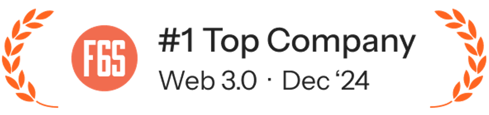

import Link from '@docusaurus/Link';

**Werenode classée première entreprise Web3.0 de France en décembre 2024**

<a href="https://www.f6s.com/werenode/" target="_blank" rel="noopener noreferrer">
    </img>
</a>

Étape importante pour les secteurs de la blockchain et de la recharge des véhicules électriques (VE) : Werenode a été officiellement reconnue comme la première entreprise Web3.0 de France en décembre 2024. Ce classement prestigieux souligne le travail pionnier de l'entreprise pour associer la blockchain aux solutions de mobilité durable, et confirme sa place de leader dans un écosystème décentralisé en pleine évolution.

### **Révolutionner la recharge des VE grâce au Web3.0**

L'approche novatrice de Werenode s'appuie sur la blockchain et les principes de la finance décentralisée (DeFi) pour démocratiser et simplifier la recharge des véhicules électriques. Grâce à un accès par jetons et à des smart contracts transparents, Werenode a bousculé les réseaux de recharge traditionnels et favorisé un écosystème ouvert, porté par ses utilisateurs, où particuliers et entreprises peuvent partager efficacement leurs infrastructures de recharge.

Le modèle unique de l'entreprise permet aux propriétaires de bornes de tokeniser leurs services de recharge, pour des transactions de pair à pair sans friction. Cette innovation supprime les intermédiaires, réduit les coûts et rend les points de recharge plus accessibles, ouvrant la voie à une mobilité électrique plus efficace et plus durable.

### **Une année de réussites majeures**

2024 a été une année décisive pour Werenode, marquée par des avancées technologiques importantes, des partenariats stratégiques et une reconnaissance dans l'univers du Web3.0. Parmi les temps forts :

- **Extension du réseau de recharge Werenode** : Werenode a fortement accru sa présence internationale, en intégrant davantage de bornes à sa plateforme décentralisée et en élargissant ses partenariats avec de grands acteurs du secteur.
- **Progrès en recharge intelligente et en durabilité** : l'entreprise a intégré des mécanismes de recharge intelligente pilotés par l'IA, qui optimisent la consommation d'énergie et renforcent la stabilité du réseau.
- **Participation à des initiatives Web3.0 de premier plan** : Werenode a contribué activement à des projets européens de recherche sur la blockchain, renforçant sa réputation de référence dans les infrastructures décentralisées.
- **Levée de fonds réussie et croissance de la communauté** : portée par la confiance croissante des investisseurs et l'engagement de sa communauté, Werenode a obtenu des financements importants pour accélérer sa mission de partage décentralisé de l'énergie.

### **Pourquoi Werenode se distingue dans l'univers du Web3.0**

Contrairement aux réseaux de recharge traditionnels, la plateforme Web3.0 de Werenode garantit transparence, confiance et sécurité grâce aux smart contracts et à des solutions d'identité décentralisée. Les conducteurs peuvent ainsi accéder aux bornes sans inscription fastidieuse ni intervention de tiers, ce qui améliore nettement l'expérience et l'accessibilité.

De plus, l'intégration de Werenode aux communautés d'énergie décentralisées (DECO) s'inscrit dans les objectifs mondiaux de durabilité, en favorisant le partage d'énergie et une meilleure utilisation des énergies renouvelables pour la recharge.

### **Perspectives : l'avenir de Werenode**

Après cette reconnaissance remarquable comme première entreprise Web3.0 de France, Werenode est prête à innover encore davantage. L'entreprise ambitionne de :

- étendre son réseau de recharge décentralisé à de nouvelles régions, pour que davantage d'utilisateurs profitent d'un accès par jetons aux bornes ;
- renforcer son rôle dans la gouvernance de la blockchain et dans le dialogue réglementaire, pour favoriser l'adoption des solutions de mobilité décentralisées ;
- continuer à perfectionner sa technologie de recharge intelligente pilotée par l'IA, pour plus d'efficacité énergétique et des coûts réduits pour les utilisateurs ;
- encourager les initiatives communautaires qui permettent à chacun de participer activement à l'avenir de la mobilité durable.

### **Un moment fort pour le Web3.0 et la mobilité électrique**

Cette distinction de première entreprise Web3.0 de France témoigne de la recherche constante d'innovation, de durabilité et de décentralisation de Werenode. Alors que le monde se tourne de plus en plus vers des solutions intelligentes et écologiques, l'écosystème de recharge de Werenode, fondé sur la blockchain, fait figure de référence dans la révolution du Web3.0.

Par son impact transformateur sur la mobilité électrique et son engagement constant pour un avenir ouvert et décentralisé, Werenode reste à l'avant-garde de l'innovation Web3.0, fixe de nouveaux standards pour le secteur et inspire la prochaine génération d'entreprises fondées sur la blockchain.
