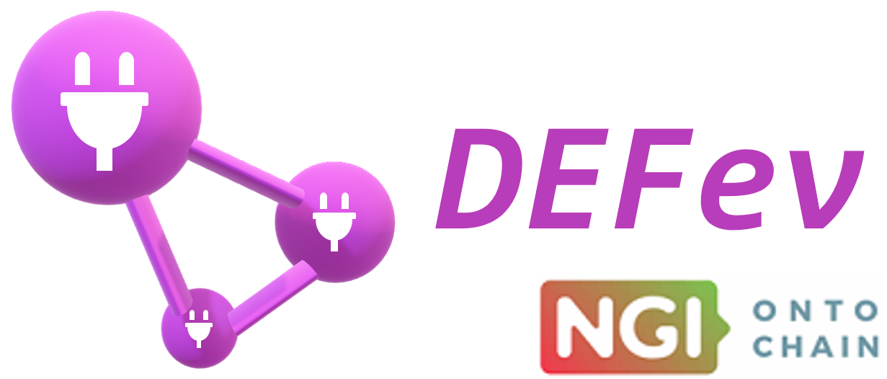
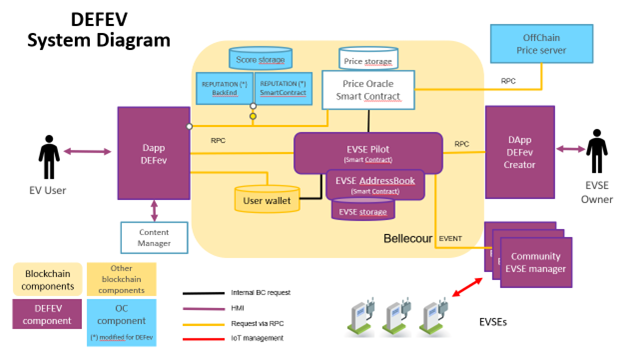
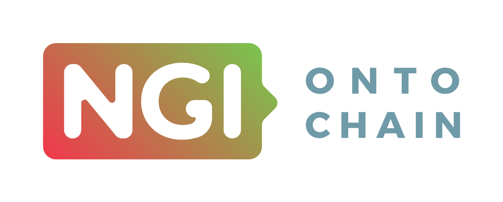

# Projet d'innovation - DEFev

Werenode s'engage à faire progresser les technologies de recharge des véhicules électriques (VE) et les solutions énergétiques décentralisées en développant des composants innovants qui s'appuient sur la blockchain, l'IoT, l'identité décentralisée et des interfaces utilisateur de pointe. Ce document présente l'un de nos principaux projets d'innovation : **DEFev**, DLT Ecosystem For Electric Vehicle Charging (écosystème DLT pour la recharge des véhicules électriques). Nous avons également développé plusieurs autres systèmes Web3.0 : **DID-IMP**, **IOTPAY**, **DECO** développé avec **OP Mobility** et **SII**, la **version à commande vocale Alexa** de Werenode, développée avec l'**ElectroShaker Lab** de Renault, et la version **LG Web OS** de notre application, développée avec **LG Nova**.

## DEFev - Gestion décentralisée de la recharge des VE

**DEFev** est une application web entièrement décentralisée, conçue pour offrir une expérience fluide de gestion de la recharge grâce à la blockchain. DEFev vise à donner aux utilisateurs un contrôle total sur leurs transactions et leurs données de recharge.

<a href="https://defev.io/" target="_blank" rel="noopener noreferrer">
    </img>
</a>

### Fonctionnalités clés :

- **Paiements sur la blockchain** : DEFev permet de gérer directement le paiement des recharges avec des portefeuilles blockchain comme **MetaMask**. C'est une solution de paiement sécurisée et décentralisée, sans intermédiaire.
- **Intégration Web3** : DEFev utilise **Web3.js** pour interagir directement avec la blockchain. Les utilisateurs peuvent ainsi connecter leur portefeuille et interagir avec les smart contracts de recharge de Werenode.
- **Autonomie des utilisateurs** : grâce à l'architecture décentralisée, les utilisateurs gardent le contrôle total de leurs paiements et transactions, et toutes les opérations sont transparentes et enregistrées sur la blockchain.
- **Prise en charge multichaîne** : DEFev prend en charge les jetons de **Tezos** et de la **Binance Smart Chain**, respectivement le **Werecoin (WRC)** et le **BWRC**, ce qui offre de la souplesse aux utilisateurs.

## Architecture et protocole

L'architecture de DEFev repose sur plusieurs composants principaux :

1) Réseau blockchain public : la couche de base, qui garantit transparence et sécurité.
2) Smart contracts : ils automatisent la gestion de la session de recharge et de son paiement.
3) Portefeuille décentralisé : DEFev est entièrement Web3.0 et utilise MetaMask.
4) Interface utilisateur : une application web pour localiser et identifier l'équipement de recharge, démarrer ou interrompre les sessions, avec des fonctions supplémentaires.

Voici une vue simplifiée de l'architecture de DEFev :

    </img>

### Collaboration :

**DEFev** a été développé dans le cadre de **NGI Ontochain**. DEFev a reçu pour cela un financement : convention de subvention n° 957338.

<a href="https://ontochain.ngi.eu/" target="_blank" rel="noopener">
    </img>
</a>

### Avantages :

- **Transparence totale** : les transactions sont enregistrées sur la blockchain, ce qui garantit une transparence totale pour les opérateurs de bornes comme pour les conducteurs.
- **Paiements sécurisés** : avec des portefeuilles blockchain comme MetaMask, DEFev supprime les intermédiaires et garantit des transactions rapides et sécurisées.
- **Expérience fluide** : grâce à la fonction **Plug&Charge**, la recharge est simplifiée et demande un minimum d'actions pour démarrer.
