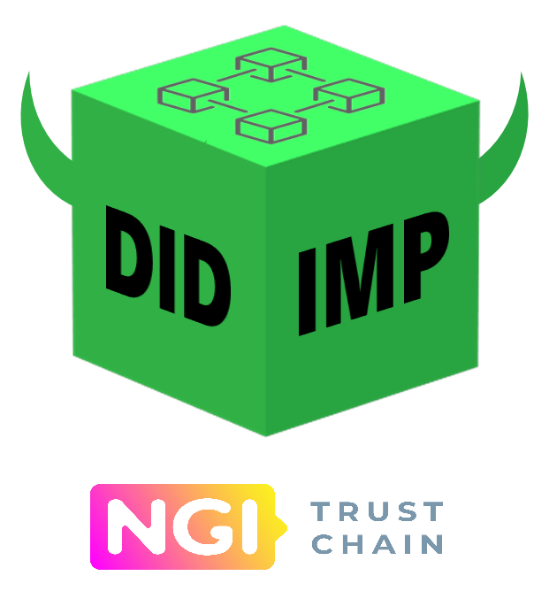
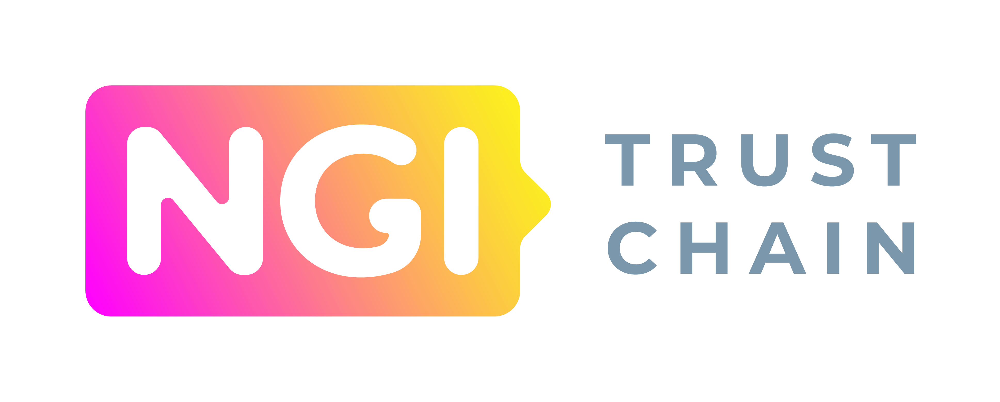

# Projet d'innovation - DID-IMP

Werenode s'engage à faire progresser le Web3.0, les technologies de recharge des véhicules électriques (VE) et les solutions énergétiques décentralisées en développant des composants innovants qui s'appuient sur la blockchain, l'IoT, l'identité décentralisée et des interfaces utilisateur de pointe. Ce document présente l'un de nos principaux projets d'innovation : **DID-IMP** (à l'origine « Decentralized public key Infrastructure for Defended IoT data Management and Procurement », mais aujourd'hui mieux décrit par « Decentralized Identity for Interoperable Mobility Platform » depuis son intégration dans l'architecture technique de Werenode). Nous avons également développé plusieurs autres systèmes Web3.0 : **DEFev**, **IOTPAY**, **DECO** développé avec **OP Mobility** et **SII**, la **version à commande vocale Alexa** de Werenode, développée avec l'**ElectroShaker Lab** de Renault, et la version **LG Web OS** de notre application, développée avec **LG Nova**.

## DID-IMP - Identité décentralisée pour une plateforme de mobilité interopérable

<a href="https://webapp.did-imp.werenode.io/" target="_blank" rel="noopener noreferrer">
    </img>
</a>

Le projet DID-IMP construit une infrastructure à clés publiques décentralisée qui permet à tout objet connecté de fournir ou d'obtenir des données sécurisées et traçables. Pour cela, Werenode s'appuie sur la blockchain afin de se passer de la structure hiérarchique classique, avec des acteurs comme l'autorité de certification (CA) et l'autorité d'enregistrement (RA). Dans DID-IMP, ces tiers de confiance qui jouent un rôle d'administrateur (RA et CA) sont remplacés par un smart contract sans frais sur la blockchain. La blockchain sert aussi de magasin de certificats, sur lequel les fournisseurs de services peuvent émettre et gérer des certificats et des attestations révocables. Une architecture aussi légère est particulièrement adaptée au partage automatique et sécurisé de données (SADS, Secure Automatic Data Sharing) dans l'Internet des objets (IoT). En effet, le SADS peut servir de bien des façons à simplifier et fluidifier le partage de données, et à sécuriser et tracer les transferts. Parmi les principaux cas d'usage :
- Véhicules connectés : les véhicules équipés de DID-IMP peuvent partager automatiquement des données pour les péages, le stationnement, la recharge (électricité ou hydrogène) et d'autres services liés au transport, ce qui simplifie la vie des conducteurs. Ils peuvent aussi transmettre automatiquement leurs données d'entretien aux organismes concernés.
- Santé à distance : les systèmes SADS rendent possibles des services de santé à distance, comme la téléconsultation et la surveillance des patients, et améliorent l'accès aux soins. Des capteurs peuvent aussi collecter des données sur la santé et le comportement des patients, et contrôler leur transmission à des intervenants accrédités.
- Villes cognitives : l'IoT joue un rôle important pour des villes plus intelligentes, plus soucieuses de l'environnement et plus efficaces. Des applications comme la gestion intelligente du trafic, de l'eau et des déchets ou la sécurité publique reposent sur des transferts de données sécurisés pour optimiser leur fonctionnement et protéger les données des citoyens.
- Gestion de l'énergie : dans le secteur de l'énergie, des objets connectés comme les compteurs intelligents et les capteurs du réseau transmettent des données sur la consommation et la distribution d'énergie. Des transferts sécurisés aident les fournisseurs à garantir l'exactitude des données et à les protéger contre les accès non autorisés. C'est aussi un élément clé pour construire des communautés d'énergie locales et décentralisées.
- Et aussi : maison connectée, maintenance, logistique...

En résumé, nous construisons une solution de partage automatique et sécurisé de données, qui améliore leur traçabilité, sécurise leurs flux et permet aux entreprises de réduire leurs charges administratives, de gagner du temps et de l'argent, tout en offrant à leurs clients un partage de données mieux protégé. Les utilisateurs restent en effet propriétaires de leurs données IoT et en gardent le contrôle, tout en accordant l'accès à des parties précises grâce à des attestations avec autorisations. Notre solution SADS aide aussi à gérer les flux de données sensibles et à respecter les nouvelles réglementations européennes et internationales. Elle s'appuie pour cela sur la traçabilité native de la blockchain, combinée au processus proposé par DID-IMP : chaque transfert de données donne lieu à une transaction tracée sur la blockchain, qui enregistre aussi les principales caractéristiques réglementaires des données échangées.

### Fonctionnalités clés

- **Identité décentralisée (DID)** : DID-IMP s'appuie sur l'**identité décentralisée** pour permettre aux utilisateurs de s'authentifier sur différentes plateformes sans dépendre d'autorités centrales. Ils gardent ainsi la maîtrise de leurs données et de leurs identifiants.
- **Interopérabilité** : grâce à un protocole d'identité ouvert et décentralisé, les utilisateurs peuvent s'authentifier et utiliser plusieurs services sans rupture. C'est une étape clé vers un partage automatique de données unifié et simple, quels que soient le réseau et le fournisseur.
- **Respect de la vie privée** : avec DID-IMP, les informations personnelles des utilisateurs ne sont pas stockées sur des serveurs centraux, ce qui réduit le risque de fuite de données. Seules les informations nécessaires sont partagées, de façon sécurisée.

### Collaboration

**DID-IMP** a été développé dans le cadre de **NGI Trustchain**. **DID-IMP** est le projet d'**identité décentralisée** de Werenode : il vise à offrir aux utilisateurs un moyen sûr et respectueux de la vie privée de s'authentifier et d'interagir avec l'écosystème Werenode. DID-IMP a été développé grâce au projet NGI Trustchain financé par l'UE (convention de subvention n° 101093274).

<a href="https://trustchain.ngi.eu/" target="_blank" rel="noopener">
    </img>
</a>

### Une approche centrée sur l'utilisateur

DID-IMP a été développé selon une méthodologie centrée sur l'utilisateur. Des entretiens menés avec les entreprises bêta-testeuses tout au long du développement nous ont permis d'identifier les besoins clés suivants :

- Accès aux données en temps réel. Les clients doivent pouvoir accéder en temps réel aux données produites par les objets connectés. C'est indispensable pour prendre des décisions rapides et éclairées à partir des informations les plus récentes.

- Intégrité des données produites par les capteurs et les objets. Les utilisateurs doivent avoir la garantie que les données collectées sont exactes et n'ont pas été altérées pendant leur transmission. Les mesures d'intégrité sont essentielles pour que les informations issues de l'IoT restent fiables et dignes de confiance.

- Données infalsifiables. Les clients ont besoin d'un système qui garantit qu'une donnée enregistrée ne peut pas être modifiée ou manipulée sans que cela se voie. Décentralisée et immuable, la blockchain offre un mécanisme sûr pour garantir l'intégrité des données IoT.

- Contrôle d'accès et autorisations, avec une gestion fine de qui peut consulter et modifier les données IoT. Les utilisateurs ont besoin de mécanismes de contrôle d'accès solides. Des autorisations fines permettent de contrôler chaque aspect de l'accès aux données, pour que seules les personnes ou les objets autorisés puissent interagir avec certaines données.

- Identification des objets dans le système. Les clients veulent une méthode fiable pour identifier et authentifier les objets connectés dans le système. Une identification sécurisée garantit que chaque donnée est attribuée à la bonne source et empêche des objets non autorisés de rejoindre le réseau.

- Passage à l'échelle, débit et interopérabilité du système. Les utilisateurs ont besoin d'un système capable de gérer un nombre croissant d'objets connectés. Un débit élevé est nécessaire pour traiter et valider efficacement les transactions sur la blockchain. L'interopérabilité garantit une communication fluide entre des objets et des plateformes variés.

- Accessibilité pour le consommateur final. Les utilisateurs attendent une interface simple et facile d'accès pour les consommateurs finaux. Ainsi, des personnes sans compétences techniques peuvent elles aussi utiliser les données des objets connectés et en tirer parti.

- Facilité d'installation et d'utilisation. Les clients veulent un système simple à mettre en place et à utiliser, qui réduit la complexité de l'intégration des objets connectés au réseau blockchain. Une installation simplifiée accélère l'adoption et le déploiement de la solution.

Répondre à ces besoins nous a permis de créer un système sûr, efficace et simple d'utilisation, qui s'appuie sur la blockchain pour garantir l'intégrité des données, leur caractère infalsifiable et un accès contrôlé dans les échanges entre objets connectés.

### Vidéo

---
