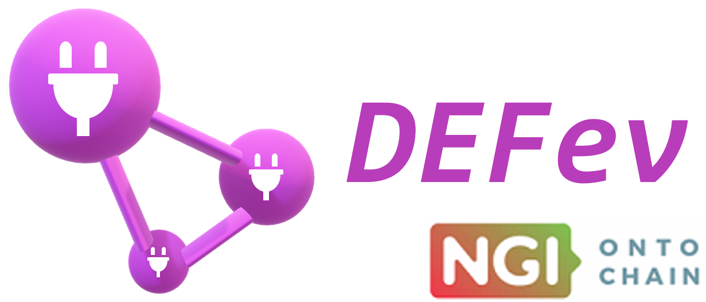
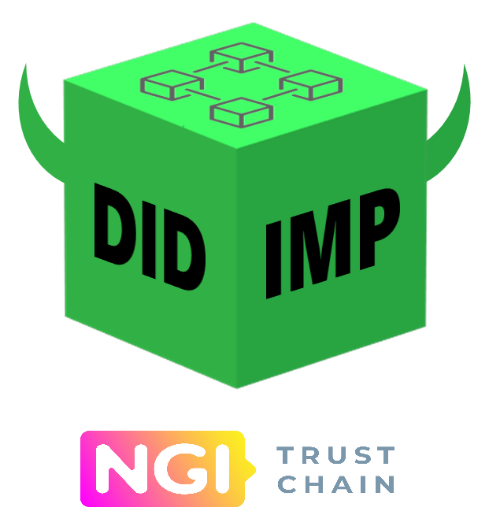
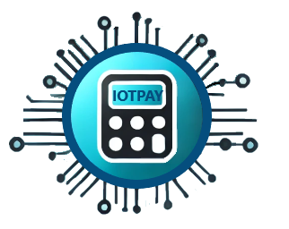

# Projets d'innovation

Werenode s'engage à faire progresser les technologies de recharge des véhicules électriques (VE) en développant des solutions innovantes qui s'appuient sur la blockchain, l'IoT, l'identité décentralisée et des interfaces utilisateur de pointe. Ce document présente nos principaux projets d'innovation : **DEFev**, **DID-IMP**, **IOTPAY** et la **version à commande vocale Alexa** de Werenode, développée avec l'**ElectroShaker Lab** de Renault.

## DEFev - Gestion décentralisée de la recharge des VE

**DEFev** est une application web entièrement décentralisée, conçue pour offrir une expérience fluide de gestion de la recharge grâce à la blockchain. DEFev vise à donner aux utilisateurs un contrôle total sur leurs transactions et leurs données de recharge. DEFev a été développé grâce au projet NGI Ontochain financé par l'UE (convention de subvention n° 957338).

<a href="https://defev.io/" target="_blank" rel="noopener noreferrer">
    </img>
</a>

### Fonctionnalités clés :

- **Paiements sur la blockchain** : DEFev permet de gérer directement le paiement des recharges avec des portefeuilles blockchain comme **MetaMask**. C'est une solution de paiement sécurisée et décentralisée, sans intermédiaire.
- **Intégration Web3** : DEFev utilise **Web3.js** pour interagir directement avec la blockchain. Les utilisateurs peuvent ainsi connecter leur portefeuille et interagir avec les smart contracts de recharge de Werenode.
- **Autonomie des utilisateurs** : grâce à l'architecture décentralisée, les utilisateurs gardent le contrôle total de leurs paiements et transactions, et toutes les opérations sont transparentes et enregistrées sur la blockchain.
- **Prise en charge multichaîne** : DEFev prend en charge les jetons de **Tezos** et de la **Binance Smart Chain**, respectivement le **Werecoin (WRC)** et le **BWRC**, ce qui offre de la souplesse aux utilisateurs.

### Collaboration :

**DEFev** a été développé dans le cadre de **NGI Ontochain**.

### Avantages :

- **Transparence totale** : les transactions sont enregistrées sur la blockchain, ce qui garantit une transparence totale pour les opérateurs de bornes comme pour les conducteurs.
- **Paiements sécurisés** : avec des portefeuilles blockchain comme MetaMask, DEFev supprime les intermédiaires et garantit des transactions rapides et sécurisées.
- **Expérience fluide** : grâce à la fonction **Plug&Charge**, la recharge est simplifiée et demande un minimum d'actions pour démarrer.

## DID-IMP - Identité décentralisée pour une plateforme de mobilité interopérable

**DID-IMP** est le projet d'**identité décentralisée** de Werenode. Il vise à offrir aux utilisateurs un moyen sûr et respectueux de la vie privée de s'authentifier et d'interagir avec l'écosystème Werenode. DID-IMP a été développé grâce au projet NGI Trustchain financé par l'UE (convention de subvention n° 101093274).

<a href="https://did-imp.werenode.io/" target="_blank" rel="noopener noreferrer">
    </img>
</a>

### Fonctionnalités clés :

- **Identité décentralisée (DID)** : DID-IMP s'appuie sur l'**identité décentralisée** pour permettre aux utilisateurs de s'authentifier sur différentes plateformes sans dépendre d'autorités centrales. Ils gardent ainsi la maîtrise de leurs données et de leurs identifiants.
- **Interopérabilité** : grâce à un protocole d'identité ouvert et décentralisé, les utilisateurs peuvent s'authentifier et utiliser plusieurs services de mobilité électrique sans rupture. C'est une étape clé vers une expérience de recharge unifiée et simple, quels que soient le réseau et le fournisseur.
- **Respect de la vie privée** : avec DID-IMP, les informations personnelles des utilisateurs ne sont pas stockées sur des serveurs centraux, ce qui réduit le risque de fuite de données. Seules les informations nécessaires sont partagées, de façon sécurisée et chiffrée.

### Collaboration :

**DID-IMP** a été développé dans le cadre de **NGI Trustchain**.

### Avantages :

- **Meilleure protection de la vie privée** : les utilisateurs gardent le contrôle de leurs données, pour des échanges plus sûrs et plus respectueux de leur vie privée.
- **Moins de dépendance aux autorités centrales** : avec une identité décentralisée, les utilisateurs passent d'une plateforme ou d'un service à l'autre sans multiplier les identifiants.
- **Recharge simplifiée** : DID-IMP donne accès aux bornes du réseau Werenode et aux services partenaires sans avoir à créer plusieurs comptes.

## IOTPAY - Solution de paiement automatique basée sur l'IoT - En collaboration avec Gapask

**IOTPAY** est la solution de paiement innovante de Werenode. Elle associe l'**Internet des objets (IoT)** et la blockchain pour permettre des paiements automatiques fluides et sécurisés. IOTPAY est développé grâce au projet NGI Sargasso financé par l'UE (convention de subvention n° 101092887).

<a href="https://werenode.com/" target="_blank" rel="noopener noreferrer">
    </img>
</a>

<a href="https://ngisargasso.eu/" target="_blank" rel="noopener">
    </img>
</a>

### Fonctionnalités clés :

- **Intégration IoT** : IOTPAY intègre des **objets connectés**, comme les prises Shelly et d'autres points de recharge intelligents, pour traiter les paiements de façon directe et automatisée.
- **Paiements sur la blockchain** : les paiements sont exécutés par des smart contracts sur **Tezos** ou la **Binance Smart Chain**, ce qui garantit des transactions sûres et immuables. Le processus de paiement est ainsi transparent et accessible aux utilisateurs comme aux opérateurs de parcs d'objets connectés.
- **Contrôle du service en temps réel** : IOTPAY permet de démarrer, de mettre en pause et d'arrêter un service depuis un objet connecté, avec un paiement traité en temps réel. Les utilisateurs disposent ainsi de souplesse et d'un contrôle total sur leurs objets.

### Collaboration :

**IOTPAY** est développé dans le cadre de **NGI Sargasso**.

### Avantages :

- **Paiements automatisés** : les paiements sont entièrement automatisés, sans validation manuelle de chaque transaction.
- **Sécurité renforcée** : en associant IoT et blockchain, IOTPAY garantit des données de paiement sécurisées et infalsifiables.
- **Faibles coûts de transaction** : la blockchain permet des micro-transactions à un coût bien inférieur à celui des passerelles de paiement classiques.

## Version à commande vocale Alexa - En collaboration avec l'ElectroShaker Lab de Renault

Werenode s'est associé à l'**ElectroShaker Lab** de Renault pour développer une version de l'application Werenode à **interface vocale Alexa (IHM vocale)**. Cette collaboration vise à proposer une gestion de la recharge mains libres, par la voix, plus simple et plus accessible.

### Fonctionnalités clés :

- **Intégration de la voix Alexa** : cette version intègre **Amazon Alexa**, ce qui permet d'interagir avec la plateforme Werenode par commandes vocales. Les utilisateurs peuvent trouver une borne, lancer une recharge et en suivre l'avancement par de simples commandes vocales.
- **IHM simple d'utilisation** : l'interface vocale a été conçue pour être très accessible. Les utilisateurs gèrent facilement leurs recharges en déplacement, sans écran tactile ni application mobile.
- **Informations en temps réel** : les utilisateurs peuvent demander à Alexa des informations en temps réel, comme l'état de la recharge, les bornes disponibles à proximité ou le coût de la session.

### Collaboration :

Ce projet a été développé en collaboration avec l'ElectroShaker Lab de Renault.

### Avantages :

- **Confort du mains libres** : l'interface vocale Alexa permet de gérer la recharge sans manipuler d'appareil mobile, pour plus de confort et de sécurité, notamment en conduisant.
- **Collaboration avec un leader du secteur** : grâce à l'ElectroShaker Lab de Renault, Werenode est à la pointe de l'intégration entre technologies automobiles et interfaces vocales.
- **Meilleure accessibilité** : l'interface vocale rend l'application Werenode plus accessible aux utilisateurs qui préfèrent ou qui ont besoin de la commande vocale, notamment les personnes en situation de handicap.

## DECO - Communautés d'énergie décentralisées - En collaboration avec OP Mobility et SII

**DECO** (Decentralized Energy COmmunities) est un projet d'innovation qui vise à créer des systèmes décentralisés de gestion de la production et de la consommation d'énergie à l'échelle d'une communauté. Il réunit des partenaires comme **OP Mobility**, **SII** et Werenode, qui combinent leur expertise en gestion de l'énergie, en analyse de données et en blockchain. Le projet a aussi bénéficié de contributions clés de **Geeps**, **Innowide** et **Gibsol**.

### Objectifs :

- **Gestion décentralisée de l'énergie** : DECO vise à gérer des **communautés d'énergie décentralisées** réunissant producteurs-consommateurs et consommateurs à l'échelle locale (par exemple dans un rayon de deux kilomètres). La communauté peut comprendre des panneaux solaires, des batteries de stockage, des bornes de recharge, etc.
- **Optimisation énergétique** : développer un **algorithme de transfert et d'optimisation de l'énergie** qui s'appuie sur la **blockchain**, l'**IoT** et l'**IA** pour optimiser la consommation et les échanges d'énergie au sein des communautés et entre elles.
- **Système de gestion de l'énergie (EMS)** : chaque membre de la communauté dispose d'un EMS qui gère sa production et sa consommation d'énergie, grâce à des objets connectés et à des batteries pour stocker et mieux utiliser l'énergie produite localement.

### Composants clés :

1. **La blockchain pour la traçabilité de l'énergie** : le projet utilise la blockchain pour tracer la production et la consommation d'énergie, ce qui permet une gestion de l'énergie **transparente et auditable**.
2. **Système de gestion de l'énergie (EMS)** : l'EMS comprend des compteurs intelligents, une batterie de stockage en option et une connexion à un moteur d'IA qui fournit des recommandations d'optimisation.
3. **Intégration à l'application mobile** : l'**application mobile Werenode** existante sera enrichie pour permettre aux utilisateurs de gérer leur consommation d'énergie, de configurer leur EMS et de suivre les données énergétiques de la communauté.

### Collaboration :

**DECO** réunit plusieurs partenaires :
- **OP Mobility (anciennement Plastic Omnium)** : apporte son expertise des batteries pour le stockage de l'énergie.
- **SII** : apporte son expertise en analyse de données, IoT et IA pour l'optimisation énergétique.

### Avantages :

- **Optimisation de l'énergie verte** : en utilisant au maximum l'énergie renouvelable produite localement, DECO réduit les coûts d'électricité et l'empreinte carbone.
- **Résilience de la communauté** : le modèle énergétique décentralisé renforce l'indépendance énergétique de la communauté et sa résilience face aux perturbations extérieures.

### Pitch :

## Intégration LG WebOS TV - L'application Werenode pour les Smart TV
Werenode repousse sans cesse les limites de la recharge des véhicules électriques (VE) en explorant de nouvelles plateformes pour la rendre plus accessible. L'un de nos projets marquants est l'intégration de l'**application Werenode** à la **plateforme WebOS TV de LG**, pour gérer la recharge de son VE confortablement depuis chez soi.
Werenode a collaboré avec **LG** pour créer une version spécifique de l'application Werenode pour la **plateforme WebOS TV** de LG. Les utilisateurs peuvent ainsi gérer leurs sessions de recharge depuis leur Smart TV, ce qui rend le suivi et le contrôle de la recharge plus simples et plus intuitifs pour tout le foyer.

### Objectifs :
- **Accessibilité** : faire connaître l'écosystème de recharge Werenode à un plus large public en le rendant accessible depuis les **Smart TV LG**.
- **Interaction simplifiée** : faciliter la gestion de la recharge en l'intégrant au quotidien du foyer, avec une interface familière.
- **Adoption plus large de la recharge intelligente** : promouvoir la recharge intelligente en s'appuyant sur la base d'utilisateurs de LG et sa plateforme WebOS.

### Composants clés :
1. **Application Werenode pour WebOS** : une version adaptée de l'application Werenode est disponible sur les **Smart TV LG**, avec une interface grand écran pour gérer la recharge.
2. **Intégration aux services existants** : l'application TV s'intègre à l'écosystème Werenode et permet notamment de trouver une borne, de lancer et suivre une recharge, et de suivre sa consommation d'énergie.
3. **Interface interactive** : conçue spécifiquement pour **WebOS**, l'application offre une interface agréable et intuitive, optimisée pour la télécommande.

### Collaboration :
- **LG Electronics** : en préparation de l'InnoFest 2023 à San Francisco, LG a apporté son expertise des **Smart TV** et de WebOS pour nous aider à développer une expérience Werenode sur mesure pour ses utilisateurs. Cette collaboration a associé l'expertise de Werenode en recharge de VE à la large présence de LG dans l'électronique grand public, pour une intégration sans couture.
  
### Avantages :
- **Gestion pratique de la recharge** : les utilisateurs gèrent la recharge de leur VE directement depuis leur salon, sans smartphone ni ordinateur. C'est plus pratique pour tout le foyer.
- **Meilleure expérience utilisateur** : le grand écran d'un téléviseur LG WebOS offre une meilleure expérience et une plus grande inclusivité, pour trouver facilement une borne, consulter le détail d'une recharge et accéder aux analyses de consommation.
- **Sensibilisation au VE** : intégrer l'application à un appareil présent dans tous les foyers favorise l'intérêt pour les solutions de recharge et contribue à une adoption plus large de la mobilité électrique.
- **Gestion en famille** : grâce au téléviseur du foyer, tous les membres de la famille peuvent suivre et gérer la recharge des véhicules partagés.

## Conclusion

Werenode repousse sans cesse les limites de l'innovation dans l'écosystème de la recharge, avec des projets comme **DEFev**, **DID-IMP**, **IOTPAY**, **DECO**, **LG WebOS** et l'**interface vocale Alexa** développée avec Renault. Ces projets illustrent notre engagement à construire un environnement entièrement décentralisé, sûr et simple d'utilisation pour les conducteurs de VE, les opérateurs de bornes et les partenaires automobiles.

En s'appuyant sur la blockchain, l'IoT, l'identité décentralisée et les interfaces en langage naturel, Werenode rend la recharge des VE plus efficace, plus accessible et plus sûre pour tous. Restez à l'écoute pour les prochaines innovations !
